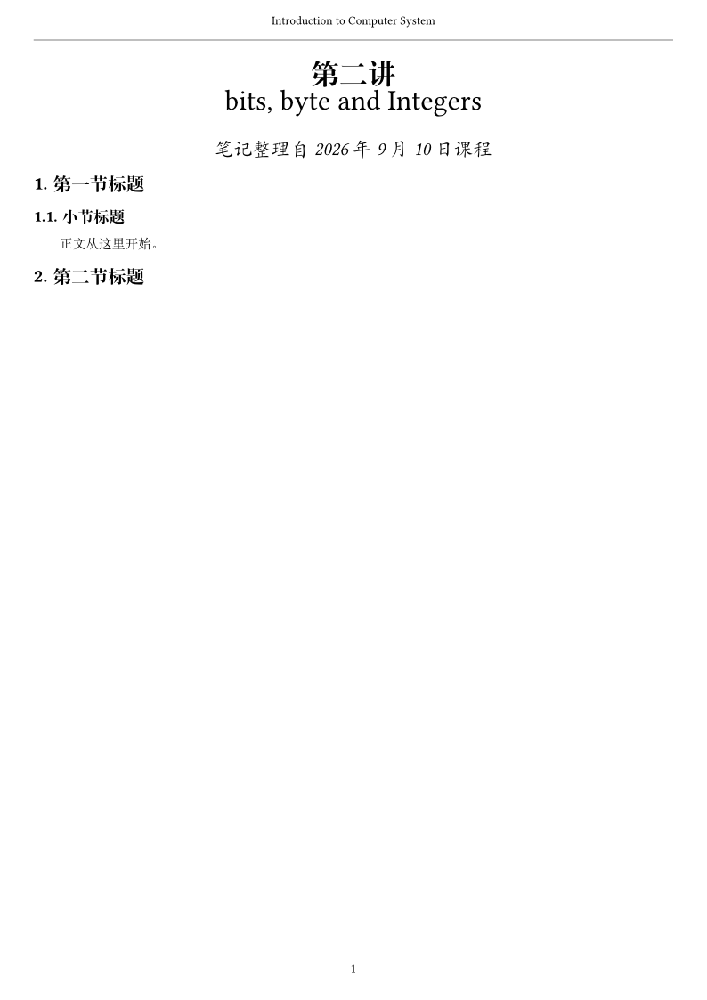

# dsh-plugin-goodtypst

Typst 是一套排版语言：一份 `.typ` 源文件编译成 PDF、PNG 或 SVG。

这个插件解决的事很具体——**在会话里写 typst 稿子时，版式守不住**。模型很容易把课程笔记写成五彩斑斓的卡片堆，把幻灯片写成左右两块带框的对比框。所以这里内置两套模板（阅读文稿 / 演示文稿），与用户认可的样例逐字同版式，再用一份风格检查把跑偏的写法拦下来。

## 两种模板

| `kind` | 适用 | 版式 | 生成的文件 |
| --- | --- | --- | --- |
| `reading` | 课程笔记、讲稿整理、长文阅读 | A4 纵向、单栏、纯黑白、ctyp 处理中英混排 | `<name>.typ` |
| `slides` | 课程汇报、论文分享、答辩 | 4:3、PKU 配色、单栏要点式 | `<name>.typ`、`template.typ`、`assets/images/pku-logo.svg` |

两份模板的版式分别对齐 `Lesson2.typ` 与 `Slides/template.typ`：页边距、页眉页脚、标题字号字重、表格与代码的居中方式都是照抄的，不是「看着像」。

## 预览

阅读文稿：A4 单栏、纯黑白，页眉一行灰线，页脚居中页码。



演示文稿：封面与内容页。页眉左侧是本页语境、右侧校徽，页脚右侧页码；标题用红、强调句用蓝，其余全是黑色正文。


## 工具

| 工具 | 作用 |
| --- | --- |
| `goodtypst_templates` | 列出两种模板的适用场景与硬性约束，用来在两者之间做选择 |
| `goodtypst_new` | 用模板起稿：写入口文件、填标题页元数据；幻灯片同时写主题与校徽。已存在的文件不覆盖 |
| `goodtypst_check` | 按风格约束检查现有 `.typ`，返回带行号的违规列表（error / warn） |
| `goodtypst_status` | 插件是否就绪；传入路径时顺带报文件行数、首行 |

## 风格约束

用户在会话里说「用 Typst 写个文稿」时，插件注入的系统提示要求模型先问一句：**阅读文稿还是演示文稿**。选定之后按模板起稿，写完用 `goodtypst_check` 自查，error 清零才算交付。

### 阅读文稿

- 整份文档只有黑白灰：没有 `fill`、`rgb(...)`、`highlight`、底色、渐变。不要写出五彩斑斓的页面。
- 不用卡片容器（`rect`、`box`、`block`），不用多栏（`columns`、`grid`）。
- 页眉页脚、字体、标题编号由模板固定：不写 `#set page`、`#set text`、`#show`。
- 表格、代码块、图片一律居中；来源说明用脚注。

### 演示文稿

- 一页一个论点：`title` 是结论（「操作带来明显提升」），`section` 是这句结论的语境，不是章节名。
- 一列往下排：禁止 `grid`、`columns` 这类并列结构，包括两列 `keypoint` 并排。
- 数字写进句子：禁止 `metric` 那种「大号数字 + 一行小字」的排版。
- 禁止带边框或底色的卡片：`rect`、`box`、`block` 配 `stroke` / `fill`。这是 AI 味最重的写法。
- 不用表格；需要对比就按「A 是……；B 是……」的顺序陈述。
- 颜色只能来自主题变量：`pku-red`、`pku-blue`、`pku-gray`、`pku-light`、`accent`。
- 一页正文不超过 60 个汉字，长句拆成要点。

风格检查是行级正则，不是语法检查：它拦的是上色、卡片、并列结构、数字块、改版式这几类典型跑偏，Typst 语法错误交给 `typst compile`。

## 用法

最省事的是让模型走一遍：

1. 「用 Typst 写一份汇报」→ 模型问：阅读文稿还是演示文稿；
2. 用户选定后，`goodtypst_new` 在指定路径生成模板副本；
3. 模型往模板里填内容，`goodtypst_check` 自查到 error 为零；
4. 交付后自行 `typst compile <file>.typ` 出 PDF。

也可以手动起稿：把 `templates/reading.typ` 或整个 `templates/slides/` 目录复制到项目里，改文件顶部的几个变量即可。

## 安装

插件的源码放在工作区的 `plugins/` 下，profile 用 `link:` 链进去，改完源码立刻可见。

```bash
# 1. 装依赖（插件自己的 node_modules）
cd plugins/dsh-plugin-goodtypst
pnpm install

# 2. 链进 profile
cd ~/.dsh/profiles/desktop
pnpm add link:/Users/capyapple/Documents/deepseek-harness/default-workspace/plugins/dsh-plugin-goodtypst
```

然后确认 profile 的 `package.json` 里 `dsh.profile.bundles` 包含 `dsh-plugin-goodtypst`，重启 DeepSeek Harness 生效。

卸载：`pnpm remove dsh-plugin-goodtypst`，并把 `dsh.profile.bundles` 里那一项删掉。

## 配置

默认值在 `cordis.patch.yml` 里声明，想改就在 profile 自己的 `cordis.patch.yml` 里用同一个 `id`（`goodtypst`）覆盖——覆盖是整块 `config` 替换。

| 字段 | 默认 | 含义 |
| --- | --- | --- |
| `typstBinary` | `typst` | 编译器位置；默认走 PATH，也可以写绝对路径 |
| `maxSourceBytes` | `4194304` | 单个 `.typ` 的读取上限，超过就报错 |

## 环境要求

- DSH `0.2.0-rc.2`（cordis `~4.0.4`）
- [Typst](https://typst.app) 编译器（本机验证版本 `0.15.1`）——插件本身不调用它，出 PDF 时用
- 阅读文稿模板依赖 `@preview/ctyp:0.3.0`，首次编译时 Typst 会自动下载并缓存

## 已知限制

- **还不会编译**：编译、错误定位、按页出图是下一版的事，见下面的路线。
- 写文件走 `ctx.fs`，受 DSH 文件策略约束；`workspace-write` 模式下只能写工作区内的路径。
- 风格检查只看写法，不看内容长度；「一页不超过 60 个汉字」这类密度要求靠提示词约束。

## 路线

1. ~~两套模板 + 风格提示 + 风格检查~~（0.2.0 已完成）
2. `goodtypst_compile`：调 `typst compile`，把 PDF 放到临时目录，失败时带回 typst 的原始报错与行号
3. 出图：`--format png --ppi` 按页出图，让模型和你都能直接看到排版结果
4. 可调：`--root`、`--font-path`、默认输出格式做成配置项

## 关于校徽

`templates/slides/assets/images/pku-logo.svg` 是北京大学校徽，原始位图打包进 SVG，这样整套模板保持纯文本、可以直接随仓库分发。校徽版权归北京大学，仓库里的这份只用于个人课程与汇报场景；换成自己的单位标志只需替换该文件。

## 开发

```bash
pnpm install
pnpm test          # node --test test/*.test.js
```

测试不启动 DSH，也不用真 `ctx`：`ctx.tools` / `ctx.fs` / `ctx.systemPrompt` 换成记录用的假对象，`defineTool` 和 `schemastery` 用真包，所以 schema 与配置默认值走的是和线上同一条代码路径。

模板改动的验证方式：`templates/slides/` 目录本身就能直接 `typst compile slides.typ`；阅读文稿需要先装 ctyp。

## 许可

MIT，见 [LICENSE](LICENSE)。
